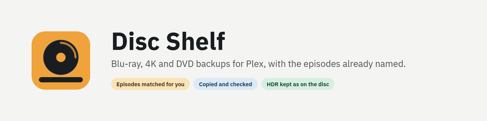
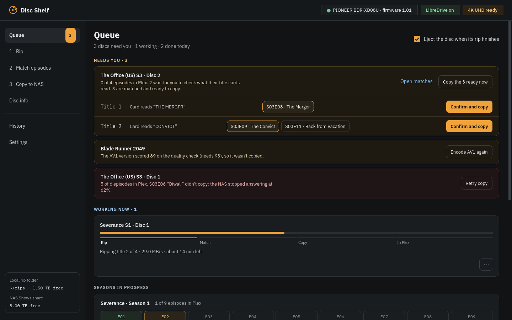
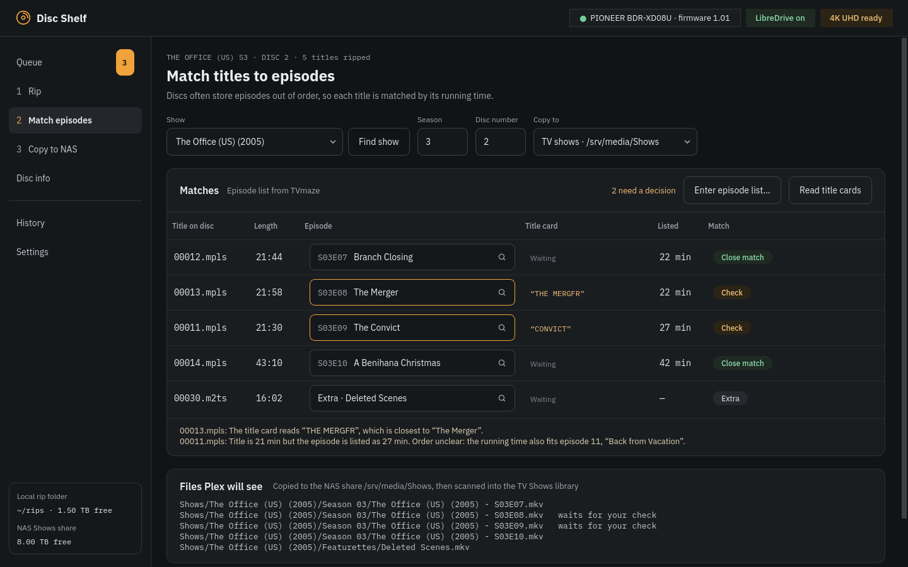

# Disc Shelf

Disc Shelf rips your Blu-rays, 4K UHD discs and DVDs, works out which episode each title is,
and copies them into your Plex library with the right names. Put a disc in, check the
matches it isn't sure about, and it does the rest.

It's a desktop app for Linux. It uses [MakeMKV](https://www.makemkv.com/) to read discs,
so it backs up discs you own exactly as they are: no re-encoding, every audio track and HDR
format kept, unless you ask for a smaller AV1 copy as well.





## What it does

- **Starts by itself.** A disc is scanned as soon as it's in the drive. Episodes or the
  film are picked out from the extras, play-alls and duplicates.
- **Names episodes for you.** Each title is matched to an episode from the first source
  that knows:
  1. the episode list printed on the case, typed in or read from a photo of it;
  2. [TheDiscDB](https://thediscdb.com), a community record of what's on each disc;
  3. the episode's title card, read from the first 90 seconds of video;
  4. running times, as a last guess.

  Anything it isn't sure about is marked **Check**, with the reason, and waits for you.
- **Copies while it rips.** Each title goes to your NAS or library folder as soon as it's
  ripped and matched, is read back to check it arrived intact, and Plex is asked to scan
  just that folder. A film is copied while it's still being ripped.
- **Tidies the library you already have.** The Library page checks a show's files against
  TVmaze, finds duplicates and misnamed or misplaced episodes, lists every rename before
  anything changes, and can undo it.
- **Keeps HDR as it is.** HDR10, HDR10+ and Dolby Vision are kept untouched by default.
  The badge on the Rip page says **RAW - No Conversion**, or lists what a setting would
  change.
- **Optional AV1 versions.** For 4K discs it can also make a smaller AV1 copy, on the
  processor (best quality) or an Nvidia graphics card (fast). Plex lists it next to the
  original, for phones, browsers and streaming away from home.
- **A queue that tells you what to do.** Discs that need you come first, then what's
  running, then each season's progress across discs ("Next: disc 3") and what finished today.

## Install

### Flatpak (recommended)

Download `DiscShelf-<version>.flatpak` from the
[latest release](https://github.com/j-a-b-r-o-n-i/DiscShelf/releases/latest) and open it:
GNOME Software and KDE Discover install it with a click. Or from a terminal:

```bash
flatpak install --user DiscShelf-0.1.0.flatpak
```

It needs [Flathub](https://flathub.org/setup) set up for the runtime it uses, which most
distributions already have. Disc Shelf isn't on Flathub itself yet, so it doesn't update on
its own: install the next release's file over it.

Then open **Disc Shelf**. The first-run setup checks the computer and fixes what it can:

- **MakeMKV** isn't bundled, because its licence doesn't allow it. The setup installs it
  from Flathub for you with one click. MakeMKV is free while in beta; the setup links to
  the current beta key if it asks for one.
- **Drive access.** MakeMKV needs the kernel's generic SCSI devices (`/dev/sg*`). Some
  distributions don't load them by default; the setup loads them and keeps them loaded,
  asking for your password once.
- **Where rips go**: pick the folders your Plex libraries use for TV shows and films. A
  NAS share mounted on this computer works.
- **Plex** (optional): sign in once so each disc is added to the right library straight away.

Everything else is inside the Flatpak: ffmpeg (with SVT-AV1, NVENC and VMAF), mkvmerge,
dovi_tool, Tesseract and the RapidOCR models.

### From source

Python 3.11 or newer, and on Arch or Fedora the installer sets up the rest:

```bash
git clone https://github.com/j-a-b-r-o-n-i/DiscShelf
cd disc-shelf
bash scripts/install_disc_shelf.sh    # MakeMKV, ffmpeg, mkvtoolnix, tesseract, dovi_tool, OCR, launcher
disc-shelf                            # or: python3 scripts/disc_shelf.py
```

`disc-shelf --fake` opens the window with sample discs, no drive needed.

## Requirements

- Linux. Windows and macOS aren't supported yet.
- An optical drive MakeMKV can read. For 4K UHD discs that means a drive that supports
  LibreDrive; see the [MakeMKV forum's drive list](https://forum.makemkv.com/forum/viewforum.php?f=19).
- Somewhere to put the files, usually a NAS share Plex reads from.

## How it works

[docs/how-it-works.md](docs/how-it-works.md) explains each screen, how episodes are matched,
how copies are checked, and where settings and jobs are kept.

## Legal

Disc Shelf doesn't break any copy protection itself; MakeMKV does the reading. Use it to
back up discs you own, and check what the law allows where you live.

## Credits

Episode data comes from [TVmaze](https://www.tvmaze.com), licensed CC BY-SA 4.0. Disc
contents come from [TheDiscDB](https://thediscdb.com). See [NOTICE.md](NOTICE.md) for the
third-party data and software Disc Shelf uses.

## Licence

GPL-3.0-or-later. See [LICENSE](LICENSE).
